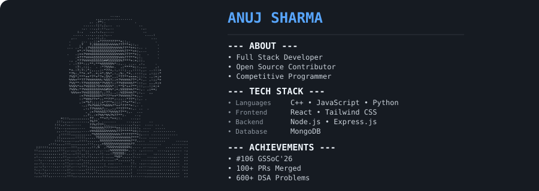

  

---

# PROJECTS

<table border="1" cellspacing="0" cellpadding="15">
  <tr>
    <td width="400" align="center" valign="middle">
      <h2>MockSpire</h2>
      

        An AI-powered mock interview platform that helps users practice interviews with real-time feedback.
      

      

        <strong>Tech Stack:</strong> 
        React • Tailwind CSS • Node.js • Express • MongoDB • Gemini API
      

      

        
        &nbsp;&nbsp;
        
      

    </td>
  </tr>
</table>

---

# CONNECT

<<<<<<< HEAD

=======
  
  
>>>>>>> 859b808 (fix: update profile stats and projects structure)

---

  <h3>⭐ Consistency compounds. Every contribution counts.</h3>

<<<<<<< HEAD

=======

>>>>>>> 859b808 (fix: update profile stats and projects structure)
